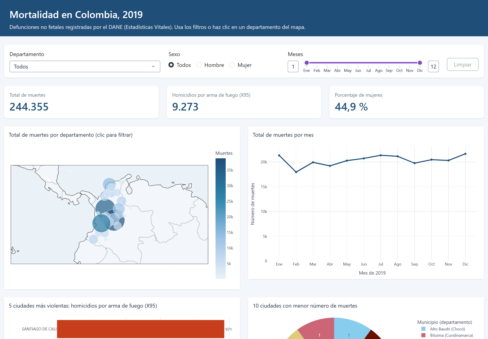
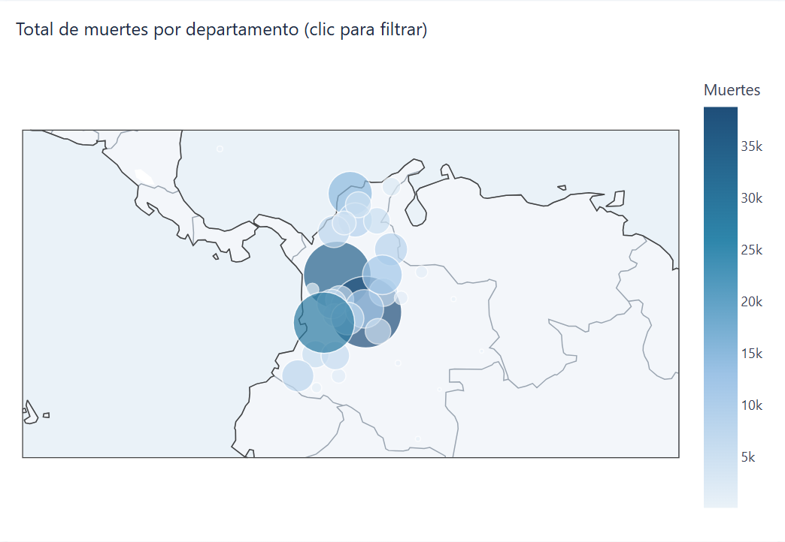
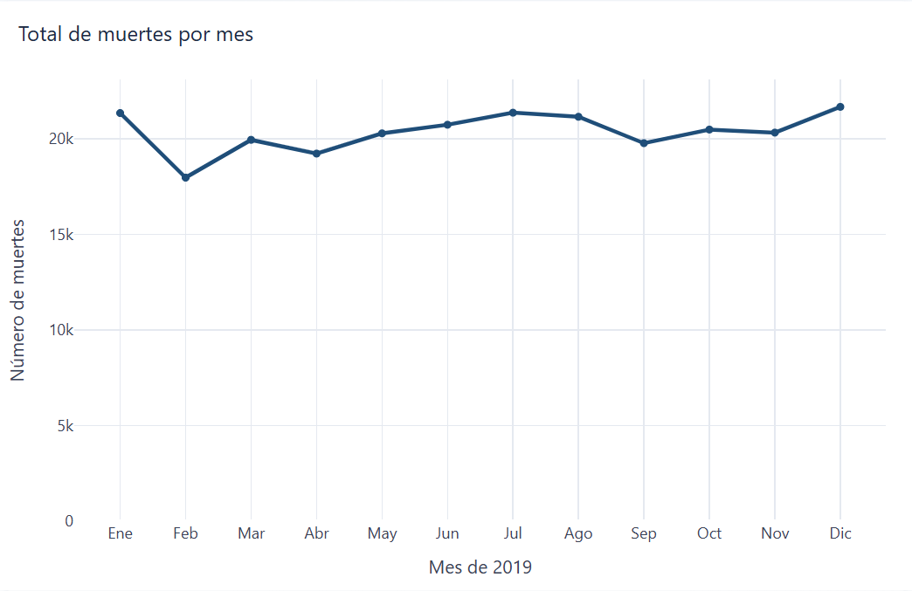
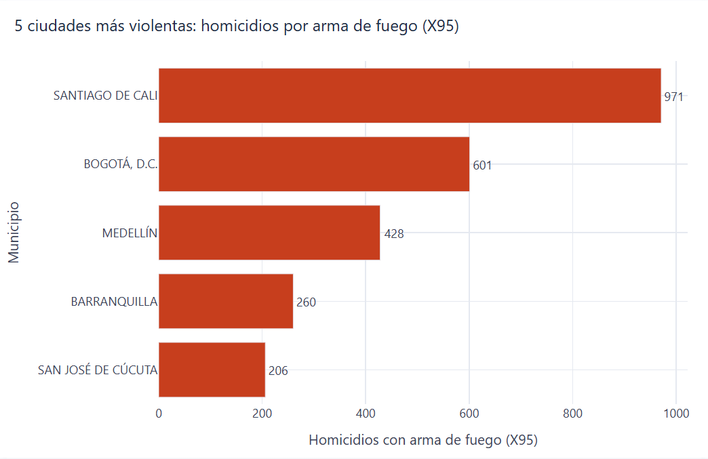
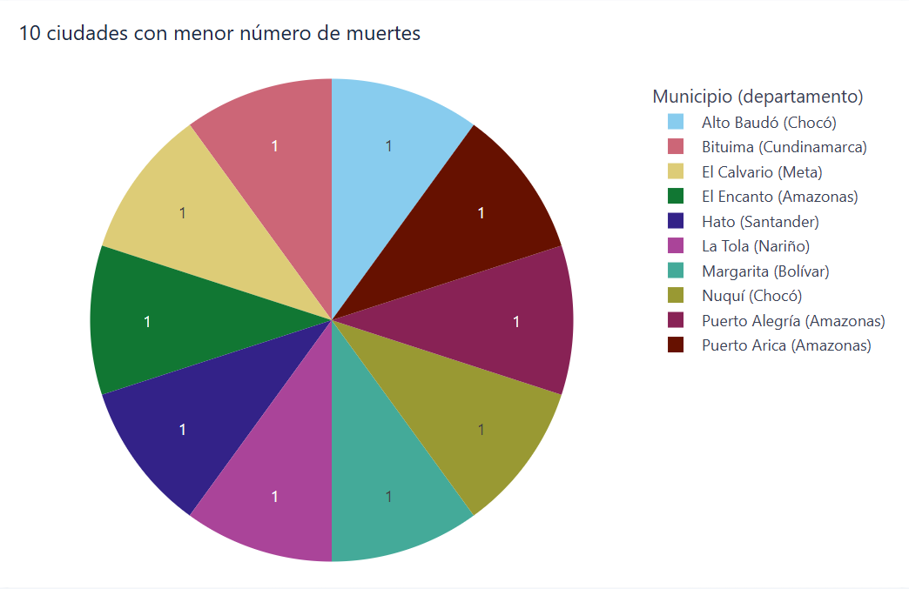
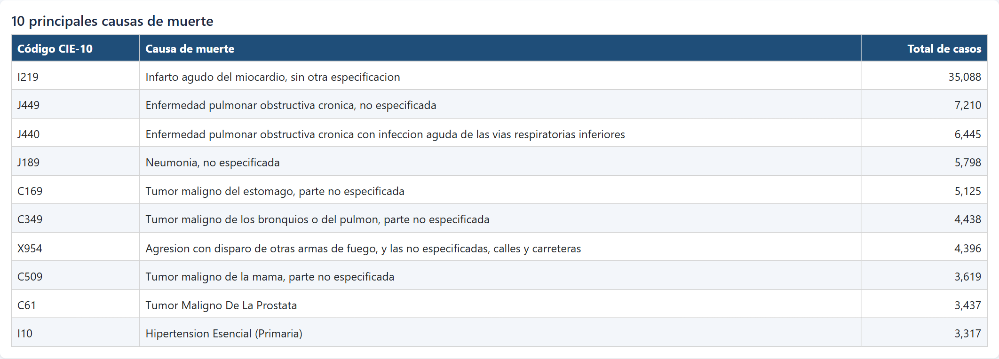
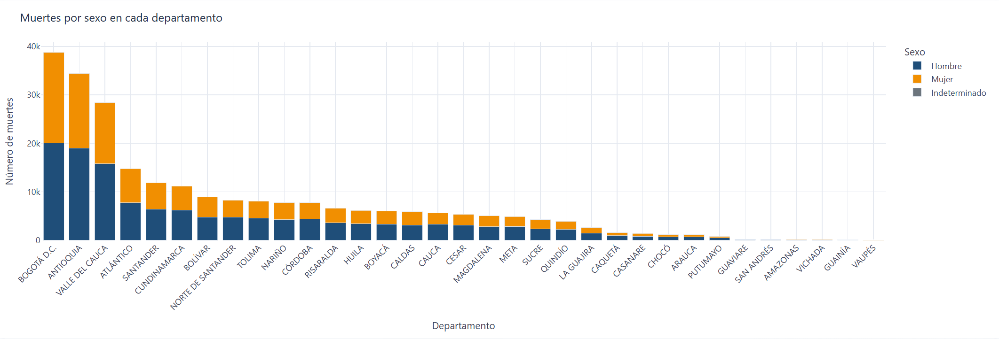
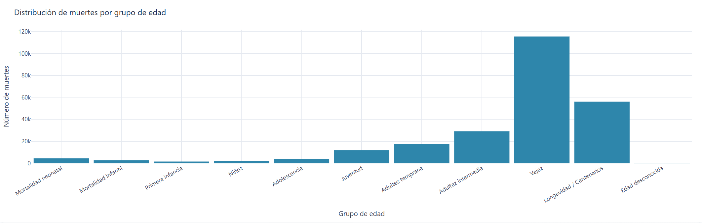
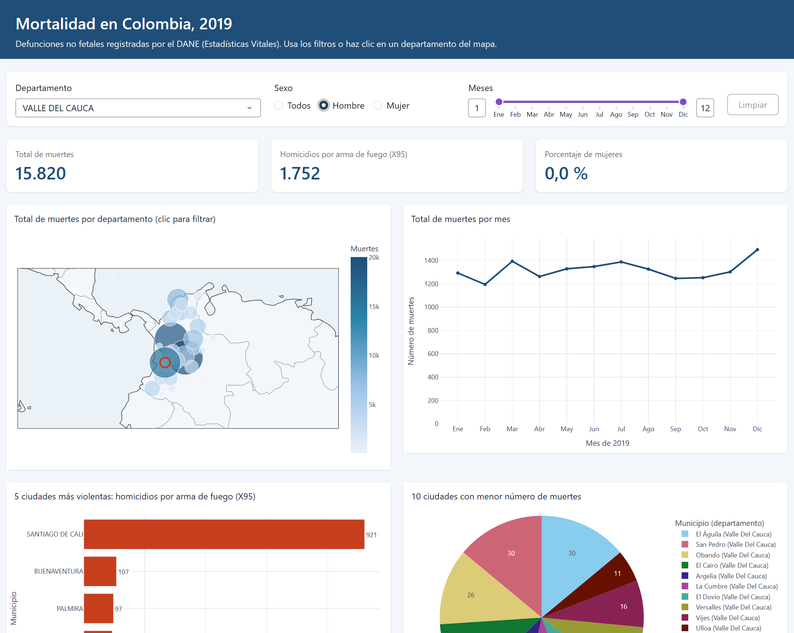

# Mortalidad en Colombia, 2019 — aplicación web interactiva

**Aplicación desplegada:** https://mortalidad-colombia-2019-r5lt.onrender.com/  
**Repositorio:** https://github.com/adeulofeut/Aplicaciones1
**Integrantes:** Ronald Andres Garcia Diaz · Juan Camilo Narváez Sánchez · Adrián Felipe Deulofeut Gil  
Aplicaciones 1 (SMTART84, Grupo 2) · Maestría en Inteligencia Artificial · Universidad de La Salle · 2026-2

## Introducción del proyecto
Aplicación web desarrollada en Python con Dash y Plotly para explorar las defunciones no fetales registradas en Colombia durante 2019 (244.355 registros de las Estadísticas Vitales del DANE). Reúne siete visualizaciones interactivas —mapa, series mensuales, rankings de municipios, principales causas, distribución por sexo y por edad— que se actualizan con filtros de departamento, sexo y rango de meses.

[COMPLETAR GRUPO: por qué es relevante analizar la mortalidad (salud pública, violencia, planeación)]

## Objetivo
Identificar patrones demográficos y regionales de la mortalidad en Colombia en 2019: dónde y cuándo se concentran las muertes, qué causas predominan, qué municipios registran más homicidios por arma de fuego y cómo se distribuyen las muertes por sexo y edad.

## Estructura del proyecto
```
mortalidad-colombia-2019/
├── app.py                    # Interfaz Dash: diseño de la página y callbacks
├── src/
│   ├── datos.py              # Carga, filtros y agregaciones (sin Dash)
│   └── graficos.py           # Una función por gráfico de Plotly
├── assets/estilos.css        # Estilos propios (Dash los carga automáticamente)
├── data/
│   ├── raw/                  # Archivos originales del DANE (.xlsx)
│   ├── mortalidad_2019.csv.gz  # Datos unidos y depurados (generado)
│   └── departamentos.csv     # Coordenadas medias por departamento (generado)
├── scripts/preparar_datos.py # Convierte los Excel en los CSV de data/
├── capturas/                 # Imágenes usadas en este README
├── requirements.txt          # Librerías para ejecutar y desplegar
└── .python-version           # Versión de Python para Render
```

## Requisitos
- Python 3.12 (también probado en 3.14).
- Librerías (`requirements.txt`): dash 4.4.1, dash-bootstrap-components 2.0.4, plotly 7.1.0, pandas 3.1.0, gunicorn 26.2.0.
- Solo para regenerar los datos desde los Excel: openpyxl 3.1.5.

## Despliegue en Render
1. Subir el repositorio a GitHub.
2. En [render.com](https://render.com): **New → Web Service** → conectar el repositorio.
3. Configuración:
   - Runtime: **Python 3** (Render lee la versión de `.python-version`).
   - Build command: `pip install -r requirements.txt`
   - Start command: `gunicorn app:server`
   - Plan: **Free**.
4. **Create Web Service**. Cada `git push` a la rama principal vuelve a desplegar la aplicación.

> En el plan gratuito el servicio se suspende tras unos 15 minutos sin uso; la primera visita puede tardar cerca de un minuto en cargar.

## Software
Python, Dash, Plotly, Dash Bootstrap Components, pandas, Gunicorn, Visual Studio Code, Git/GitHub y Render.

## Instalación
```bash
git clone https://github.com/adeulofeut/Aplicaciones1.git
cd Aplicaciones1
python -m venv .venv
.venv\Scripts\activate          # Windows  (Linux/macOS: source .venv/bin/activate)
pip install -r requirements.txt
python app.py                   # abrir http://127.0.0.1:8050
```
Para regenerar `data/` a partir de los Excel originales: `pip install openpyxl` y `python scripts/preparar_datos.py`.

## Datos y decisiones de análisis
Fuentes (DANE, *Estadísticas Vitales — EEVV 2019*, https://microdatos.dane.gov.co/index.php/catalog/696): `NoFetal2019` (defunciones), `CodigosDeMuerte` (CIE-10) y `Divipola` (códigos de departamentos y municipios).

- **Ciudades** = municipios (código DANE de 5 dígitos).
- **Ciudades más violentas:** homicidios con códigos CIE-10 **X95** (agresión con disparo de otras armas de fuego y las no especificadas), como indica el enunciado. Son 9.273 casos; el total de muertes clasificadas como homicidio en `MANERA_MUERTE` es 13.077, porque incluye otros mecanismos (armas blancas, etc.).
- **Menor índice de mortalidad:** los archivos no incluyen población, así que se usa el **número absoluto de muertes**. 13 municipios empatan con una sola muerte; el gráfico muestra 10 de ellos en orden alfabético. [COMPLETAR GRUPO: confirmar este criterio o cambiarlo por tasa con proyecciones de población del DANE]
- **Causas de muerte:** se agrupan por el código CIE-10 tal como viene en los datos (4 caracteres, o 3 cuando el registro no trae el cuarto).
- **Sexo:** 1 = Hombre, 2 = Mujer, 3 = Indeterminado (93 registros).
- **Mapa:** burbujas ubicadas en el promedio de las coordenadas de los municipios de cada departamento (Divipola).
- **Filtros:** el filtro de departamento no se aplica al mapa ni a las barras por sexo (que ya muestran todos los departamentos); allí el departamento elegido se resalta.

## Visualizaciones con explicaciones de los resultados
Con todos los filtros en «Todos» cada gráfico muestra exactamente lo que pide el enunciado.



### Mapa: muertes por departamento

Datos: Bogotá D.C. (38.760; 15,9 %), Antioquia (34.473; 14,1 %) y Valle del Cauca (28.443; 11,6 %) concentran el 41,6 % de las muertes; las menores cifras están en Vichada (188), Guainía (115) y Vaupés (87).
[COMPLETAR GRUPO: interpretación]

### Gráfico de líneas: muertes por mes

Datos: el mes con más muertes es diciembre (21.678) y el de menos, febrero (17.974).
[COMPLETAR GRUPO: interpretación]

### Gráfico de barras: 5 ciudades más violentas

Datos: Santiago de Cali (971), Bogotá D.C. (601), Medellín (428), Barranquilla (260) y San José de Cúcuta (206). En todo el país, el 93,5 % de las víctimas de X95 son hombres y el 72,7 % están entre la juventud y la adultez temprana (20 a 44 años).
[COMPLETAR GRUPO: interpretación]

### Gráfico circular: 10 ciudades con menor mortalidad

Datos: los 10 municipios mostrados registran una sola muerte cada uno (13 municipios empatan con 1).
[COMPLETAR GRUPO: interpretación]

### Tabla: 10 principales causas de muerte

Primera causa: infarto agudo del miocardio (I219), 35.088 casos. Las 10 causas suman el 32,3 % de todas las muertes; la única violenta del listado es X954 (agresión con arma de fuego en calles y carreteras, 4.396).
[COMPLETAR GRUPO: interpretación]

### Barras apiladas: muertes por sexo en cada departamento

Datos: hombres 134.573 (55,1 %), mujeres 109.689 (44,9 %), sexo indeterminado 93.
[COMPLETAR GRUPO: interpretación]

### Histograma: muertes por grupo de edad

Datos: vejez (60 a 84 años) reúne el 47,2 % de las muertes (115.453) y longevidad (85 años o más) el 22,9 % (56.061); la mortalidad neonatal suma 4.520 casos (1,8 %).
[COMPLETAR GRUPO: interpretación]

### Interactividad

Ejemplo de la captura: Valle del Cauca + Hombre → 15.820 muertes y 1.752 homicidios X95, de los cuales 921 ocurrieron en Santiago de Cali; el mapa resalta el departamento elegido.
[COMPLETAR GRUPO: ejemplo de un hallazgo al filtrar, p. ej. un departamento y un sexo]

## Conclusiones
[COMPLETAR GRUPO]
