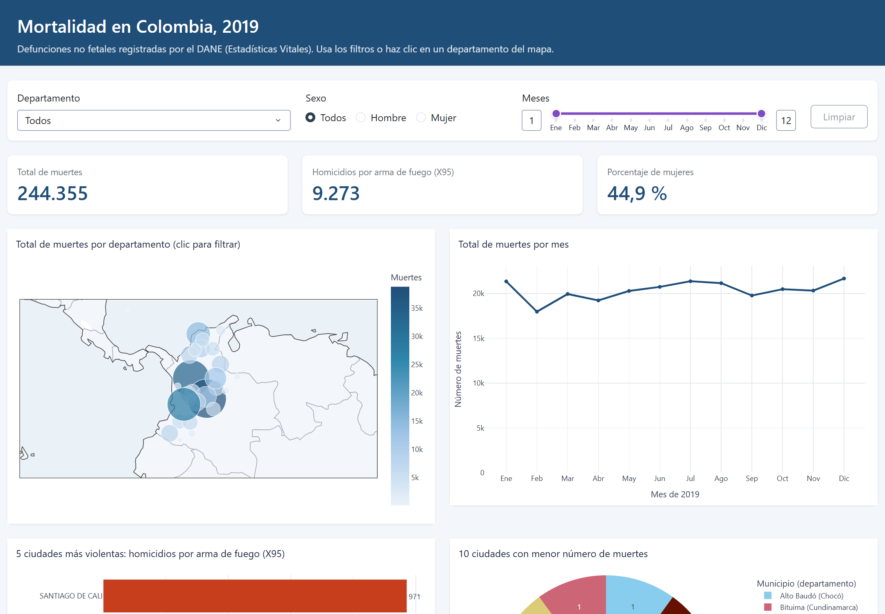
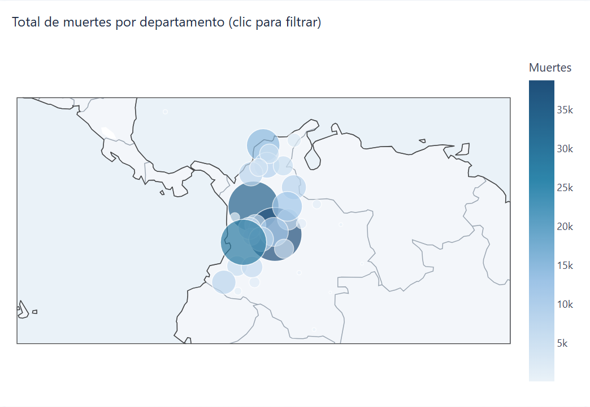
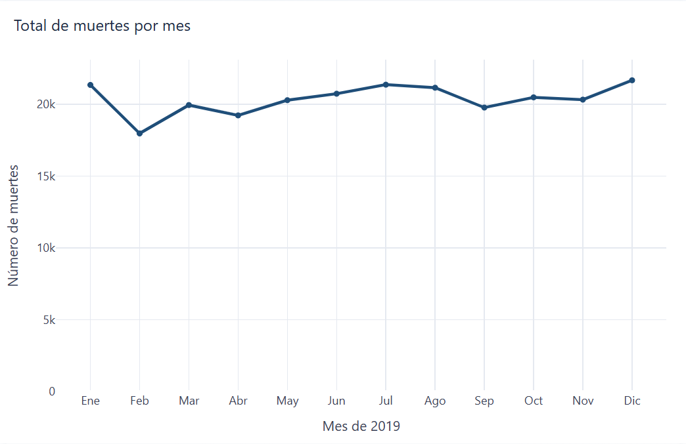
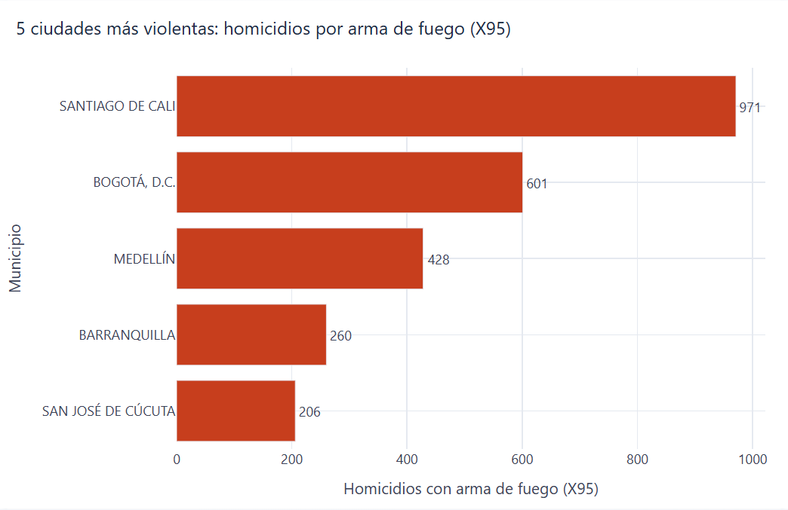
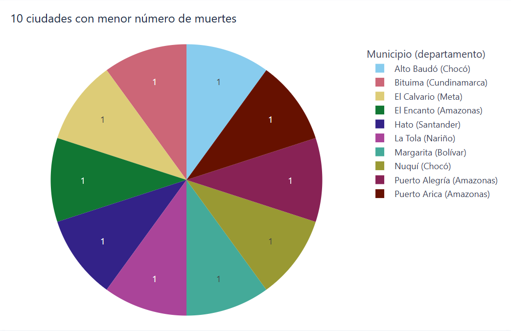
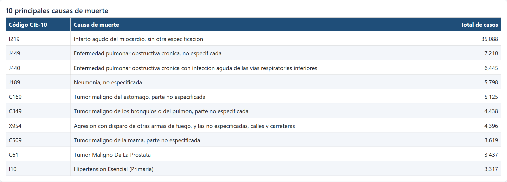
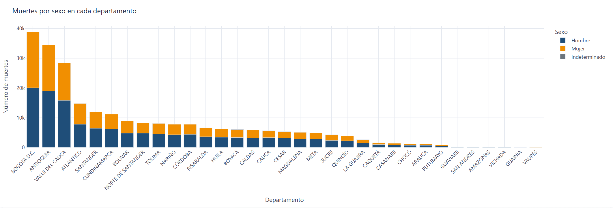
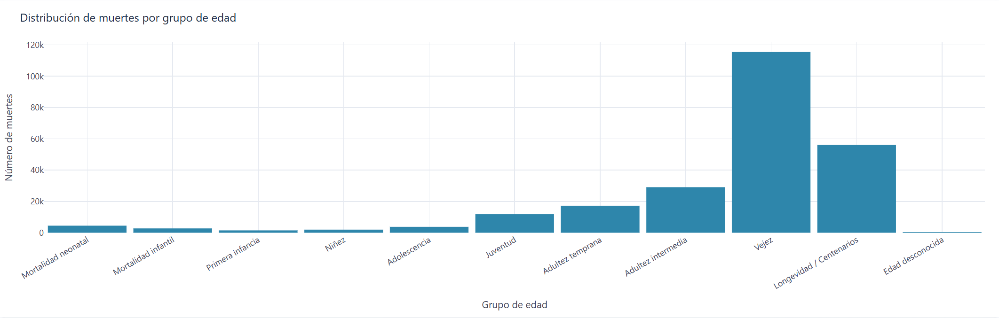
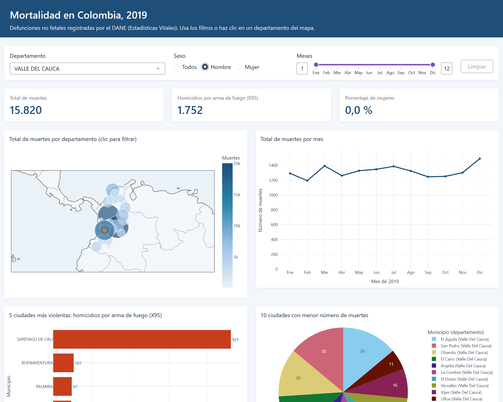

# Mortalidad en Colombia, 2019 — aplicación web interactiva

**Aplicación desplegada:** https://mortalidad-colombia-2019-r5lt.onrender.com/  
**Repositorio:** https://github.com/adeulofeut/Aplicaciones1 (carpeta `actividad4/`)
**Integrantes:** Ronald Andres Garcia Diaz · Juan Camilo Narváez Sánchez · Adrián Felipe Deulofeut Gil  
Aplicaciones 1 (SMTART84, Grupo 2) · Maestría en Inteligencia Artificial · Universidad de La Salle · 2026-2

## Introducción del proyecto
Aplicación web desarrollada en Python con Dash y Plotly para explorar las defunciones no fetales registradas en Colombia durante 2019 (244.355 registros de las Estadísticas Vitales del DANE). Reúne siete visualizaciones interactivas —mapa, series mensuales, rankings de municipios, principales causas, distribución por sexo y por edad— que se actualizan con filtros de departamento, sexo y rango de meses.

Analizar la mortalidad es clave para la salud pública: permite identificar dónde y por qué muere la población, priorizar programas de prevención (enfermedades cardiovasculares, cáncer, violencia), orientar la asignación de recursos hospitalarios y evaluar políticas de seguridad. Una herramienta interactiva facilita que estos patrones se exploren por territorio, sexo y periodo sin necesidad de procesar los microdatos.

## Objetivo
Identificar patrones demográficos y regionales de la mortalidad en Colombia en 2019: dónde y cuándo se concentran las muertes, qué causas predominan, qué municipios registran más homicidios por arma de fuego y cómo se distribuyen las muertes por sexo y edad.

## Estructura del proyecto
```
actividad4/
├── app.py                    # Interfaz Dash: diseño de la página y callbacks
├── src/
│   ├── datos.py              # Carga, filtros y agregaciones (sin Dash)
│   └── graficos.py           # Una función por gráfico de Plotly
├── assets/estilos.css        # Estilos propios (Dash los carga automáticamente)
├── data/
│   ├── raw/                  # Archivos originales del DANE (.xlsx)
│   ├── mortalidad_2019.csv.gz  # Datos unidos y depurados (generado)
│   └── departamentos.csv     # Coordenadas medias por departamento (generado)
├── scripts/preparar_datos.py # Convierte los Excel en los CSV de data/
├── capturas/                 # Imágenes usadas en este README
├── requirements.txt          # Librerías para ejecutar y desplegar
└── .python-version           # Versión de Python para Render
```

## Requisitos
- Python 3.12 (también probado en 3.14).
- Librerías (`requirements.txt`): dash 4.4.1, dash-bootstrap-components 2.0.4, plotly 7.1.0, pandas 3.1.0, gunicorn 26.2.0.
- Solo para regenerar los datos desde los Excel: openpyxl 3.1.5.

## Despliegue en Render
1. Subir el repositorio a GitHub. La aplicación está en la carpeta `actividad4/`.
2. En [render.com](https://render.com): **New → Web Service** → conectar el repositorio.
3. Configuración:
   - Root Directory: **`actividad4`**.
   - Runtime: **Python 3** (Render lee la versión de `actividad4/.python-version`).
   - Build command: `pip install -r requirements.txt`
   - Start command: `gunicorn app:server`
   - Plan: **Free**.
4. **Create Web Service**. Cada `git push` a la rama principal vuelve a desplegar la aplicación.

> En el plan gratuito el servicio se suspende tras unos 15 minutos sin uso; la primera visita puede tardar cerca de un minuto en cargar.

## Software
Python, Dash, Plotly, Dash Bootstrap Components, pandas, Gunicorn, Visual Studio Code, Git/GitHub y Render.

## Instalación
```bash
git clone https://github.com/adeulofeut/Aplicaciones1.git
cd Aplicaciones1
python -m venv .venv
.venv\Scripts\activate          # Windows  (Linux/macOS: source .venv/bin/activate)
pip install -r requirements.txt
python app.py                   # abrir http://127.0.0.1:8050
```
Para regenerar `data/` a partir de los Excel originales: `pip install openpyxl` y `python scripts/preparar_datos.py`.

## Datos y decisiones de análisis
Fuentes (DANE, *Estadísticas Vitales — EEVV 2019*, https://microdatos.dane.gov.co/index.php/catalog/696): `NoFetal2019` (defunciones), `CodigosDeMuerte` (CIE-10) y `Divipola` (códigos de departamentos y municipios).

- **Ciudades** = municipios (código DANE de 5 dígitos).
- **Ciudades más violentas:** homicidios con códigos CIE-10 **X95** (agresión con disparo de otras armas de fuego y las no especificadas), como indica el enunciado. Son 9.273 casos; el total de muertes clasificadas como homicidio en `MANERA_MUERTE` es 13.077, porque incluye otros mecanismos (armas blancas, etc.).
- **Menor índice de mortalidad:** los archivos no incluyen población, así que se usa el **número absoluto de muertes**. 13 municipios empatan con una sola muerte; el gráfico muestra 10 de ellos en orden alfabético. Una tasa por habitante sería más precisa, pero requiere incorporar las proyecciones de población del DANE; se deja como mejora futura.
- **Causas de muerte:** se agrupan por el código CIE-10 tal como viene en los datos (4 caracteres, o 3 cuando el registro no trae el cuarto).
- **Sexo:** 1 = Hombre, 2 = Mujer, 3 = Indeterminado (93 registros).
- **Mapa:** burbujas ubicadas en el promedio de las coordenadas de los municipios de cada departamento (Divipola).
- **Filtros:** el filtro de departamento no se aplica al mapa ni a las barras por sexo (que ya muestran todos los departamentos); allí el departamento elegido se resalta.

## Visualizaciones con explicaciones de los resultados
Con todos los filtros en «Todos» cada gráfico muestra exactamente lo que pide el enunciado.



### Mapa: muertes por departamento

Datos: Bogotá D.C. (38.760; 15,9 %), Antioquia (34.473; 14,1 %) y Valle del Cauca (28.443; 11,6 %) concentran el 41,6 % de las muertes; las menores cifras están en Vichada (188), Guainía (115) y Vaupés (87).
La mortalidad se concentra en los departamentos más poblados y urbanizados: Bogotá, Antioquia y Valle del Cauca suman cerca de 4 de cada 10 muertes del país, seguidos por Atlántico, Santander y Cundinamarca. En el otro extremo, los departamentos de la Orinoquía y la Amazonía (Vichada, Guainía, Vaupés) registran menos de 200 muertes cada uno. Este patrón refleja sobre todo el tamaño de la población y no necesariamente un mayor riesgo: para comparar el riesgo entre departamentos haría falta calcular tasas por cada 100.000 habitantes.

### Gráfico de líneas: muertes por mes

Datos: el mes con más muertes es diciembre (21.678) y el de menos, febrero (17.974).
El número de muertes es bastante estable a lo largo del año, entre 18.000 y 21.700 por mes. Febrero aparece como el mínimo en parte porque tiene menos días: en promedio diario (642 muertes/día) es similar a marzo y abril. El valor más alto se da en diciembre (699 muertes/día), y enero, junio y julio también están por encima del promedio, periodos que coinciden con vacaciones, festividades y mayor movilidad. No se observa una estacionalidad fuerte; la variación entre meses es moderada.

### Gráfico de barras: 5 ciudades más violentas

Datos: Santiago de Cali (971), Bogotá D.C. (601), Medellín (428), Barranquilla (260) y San José de Cúcuta (206). En todo el país, el 93,5 % de las víctimas de X95 son hombres y el 72,7 % están entre la juventud y la adultez temprana (20 a 44 años).
Santiago de Cali es, de lejos, la ciudad con más homicidios por arma de fuego: 971 casos, un 60 % más que Bogotá, pese a tener una población bastante menor. Cali concentra además más de la mitad (52,5 %) de los homicidios X95 de todo el Valle del Cauca. Las cinco ciudades reúnen el 26,6 % de estos homicidios del país, lo que muestra que la violencia con armas de fuego se concentra en los grandes centros urbanos. El perfil de las víctimas es muy marcado: casi todas son hombres jóvenes y en edad productiva.

### Gráfico circular: 10 ciudades con menor mortalidad

Datos: los 10 municipios mostrados registran una sola muerte cada uno (13 municipios empatan con 1).
Los municipios con menor mortalidad registran una sola muerte en 2019 y son, en general, territorios pequeños, rurales y apartados, varios de ellos en Amazonas y Chocó. Como hay 13 municipios empatados con una muerte, el gráfico muestra 10 en orden alfabético, por lo que todas las porciones son iguales. Este resultado debe leerse con cuidado: un conteo bajo puede deberse a la poca población y también a un posible subregistro de defunciones en zonas de difícil acceso, por lo que no implica necesariamente mejores condiciones de salud.

### Tabla: 10 principales causas de muerte

Primera causa: infarto agudo del miocardio (I219), 35.088 casos. Las 10 causas suman el 32,3 % de todas las muertes; la única violenta del listado es X954 (agresión con arma de fuego en calles y carreteras, 4.396).
Predominan las enfermedades crónicas no transmisibles. El infarto agudo del miocardio es, por mucho, la primera causa (35.088 muertes, el 14,4 % del total), casi cinco veces la segunda. Le siguen la enfermedad pulmonar obstructiva crónica (EPOC, en dos variantes), la neumonía y varios cánceres (estómago, pulmón, mama y próstata), además de la hipertensión. La única causa violenta del top 10 es la agresión con arma de fuego en calles y carreteras (X954), en séptimo lugar, lo que confirma el peso de la violencia en la mortalidad del país.

### Barras apiladas: muertes por sexo en cada departamento

Datos: hombres 134.573 (55,1 %), mujeres 109.689 (44,9 %), sexo indeterminado 93.
En todos los departamentos mueren más hombres que mujeres (55,1 % frente a 44,9 % en el total nacional). La diferencia es menor en Bogotá (51,8 % hombres) y Atlántico (52,5 %), y mucho mayor en departamentos como Guaviare (77,1 %), Guainía (67,8 %) y Amazonas (65,8 %), donde pesan más las muertes violentas y accidentales (en Guaviare son el 26,6 % de las muertes, frente al 11,6 % nacional). La sobremortalidad masculina se explica sobre todo por las edades jóvenes: entre los 20 y 44 años, el 72,9 % de los fallecidos son hombres, mientras que entre los mayores de 85 años predominan las mujeres (57,4 %), por su mayor esperanza de vida.

### Histograma: muertes por grupo de edad

Datos: vejez (60 a 84 años) reúne el 47,2 % de las muertes (115.453) y longevidad (85 años o más) el 22,9 % (56.061); la mortalidad neonatal suma 4.520 casos (1,8 %).
La distribución está fuertemente cargada hacia las edades avanzadas: el 70 % de las muertes ocurre a partir de los 60 años (vejez y longevidad), casi todas por causas naturales (96,4 %). La mortalidad en la niñez y la adolescencia es baja, aunque la neonatal (4.520 casos) supera a la de cualquier otro grupo menor de 20 años. Llama la atención el salto en juventud y adultez temprana: entre los 20 y 44 años más de la mitad de las muertes (53,1 %) son violentas o accidentales (homicidios, accidentes y suicidios), y casi una de cada tres es un homicidio.

### Interactividad

Ejemplo de la captura: Valle del Cauca + Hombre → 15.820 muertes y 1.752 homicidios X95, de los cuales 921 ocurrieron en Santiago de Cali; el mapa resalta el departamento elegido.
Los filtros permiten pasar de la visión nacional a una más específica. Al elegir Valle del Cauca y hombres, se ve que los homicidios X95 pesan mucho más que en el total del país (1.752 de 15.820 muertes, el 11 %, frente al 3,8 % nacional) y que Cali concentra la mayoría de ellos, seguida de Buenaventura y Palmira. Al cambiar el sexo a mujeres, en cambio, los homicidios X95 caen a 95 casos y las causas cardiovasculares y los cánceres dominan la tabla. El clic en el mapa y el rango de meses permiten repetir este análisis para cualquier departamento o periodo.

## Conclusiones
1. **La mayor parte de la mortalidad en Colombia en 2019 es natural y se concentra en la vejez.** El 87 % de las muertes son naturales y el 70 % ocurre después de los 60 años, con las enfermedades cardiovasculares, respiratorias crónicas y el cáncer como causas principales. La prevención de enfermedades crónicas (hipertensión, tabaquismo, detección temprana de cáncer) es la línea con mayor impacto potencial.
2. **La violencia sigue siendo un problema marcado y focalizado.** Los homicidios por arma de fuego se concentran en hombres de 20 a 44 años y en grandes ciudades, con Cali como caso más crítico. En ese grupo de edad, más de la mitad de las muertes son evitables (violentas o accidentales).
3. **Hay fuertes diferencias por sexo y territorio.** Los hombres mueren más en casi todas las edades salvo en las más avanzadas, y la brecha es mayor en departamentos periféricos.
4. **Los conteos absolutos reflejan el tamaño de la población.** Por eso Bogotá, Antioquia y Valle encabezan el mapa y los municipios pequeños aparecen como los de menor mortalidad. Como mejora, proponemos incorporar las proyecciones de población del DANE para calcular tasas por 100.000 habitantes y un mapa coroplético por departamento.
5. **La interactividad aporta valor al análisis.** Los filtros por departamento, sexo y mes permiten descubrir patrones locales que no se ven en el agregado nacional, y el despliegue en Render deja la herramienta disponible para cualquier usuario.

